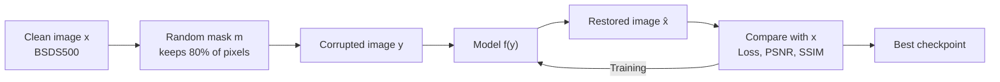

# Image Inpainting with Residual Neural Networks

**Restoring images that have 20% of their pixels missing.**

Numerical Analysis course project · Universidad Industrial de Santander (UIS) · 2026

---

## Result at a glance

| Image compared with the clean original | PSNR | SSIM |
|---|---:|---:|
| Corrupted input (baseline) | 13.54 dB | 0.278 |
| **Restored by `FRRNLite`** | **37.64 dB** | **0.981** |
| Improvement | +24.11 dB | +0.703 |

Measured on the 100 validation images. The dataset package has no separate test folder, so this same set also selected the best checkpoint.

## Authors

| Name | Student ID | Program |
|---|---|---|
| Pedro Moises Marin Angarita | 2242059 | Systems Engineering |
| Juan Pablo Rueda Angarita | 2250160 | Systems Engineering |

## The problem

**Inpainting** means filling in the missing parts of an image. Here, a clean image $\mathbf{x}$ loses random pixels and becomes the observed image $\mathbf{y}$:

$$
\mathbf{y} = \mathbf{m} \odot \mathbf{x}
$$

| Symbol | Meaning |
|---|---|
| $\mathbf{x}$ | Clean image, the target to recover |
| $\mathbf{y}$ | Corrupted image, the only input the model receives |
| $\mathbf{m}$ | Binary mask: `1` keeps the pixel, `0` removes it |
| $\odot$ | Element-wise multiplication |
| $\hat{\mathbf{x}} = f_\theta(\mathbf{y})$ | Restored image produced by the network |

Each pixel is kept with probability $p = 0.8$, so about 20% are removed and appear black. This is an **inverse problem**: many different images could produce the same $\mathbf{y}$, so the network has to learn what natural images look like.

### Project rules

| Fixed | Open to change |
|---|---|
| BSDS500 dataset | Hyperparameters |
| Corruption process | Optimizer, learning rate, and loss |
| | Preprocessing and regularization |
| | Network architecture |

## How it works

| Split | Images | Crop | Mask |
|---|---:|---|---|
| Training | 200 | Random 96×96 with horizontal flip | New random mask for every sample |
| Validation | 100 | Centered 288×288 | Fixed mask per image, for reproducible metrics |

## Models

| Name | Idea |
|---|---|
| `DeepNeuralNetwork` | The compact baseline: stacked residual blocks that work locally. The project added a global skip connection. |
| `FRRNLite` | Follows the image at full resolution for detail while a second stream shrinks it to see the global context. |
| `FRRNLiteNoSkip` | The same network with every skip connection removed, to measure how much they contribute. |

**About the names:** FRRN stands for *Full-Resolution Residual Network*. "Lite" is used because the original architecture reaches 1/32 of the image size, while this version stops at 1/8 or 1/16.

`FRRNLite` and `FRRNLiteNoSkip` differ only in the `skip` flag:

| Part of the network | `FRRNLite` | `FRRNLiteNoSkip` |
|---|---|---|
| `pre` and `post` blocks | `ResidualBlock` | `PlainBlock` |
| Output of each `FRRU` | `z + correction` | `correction` |
| Before the last convolution | `post(z) + feat` | `post(z)` |
| Network output | `conv2(z) + y` | `conv2(z)` |

**Data consistency** is an FRRN option that keeps the known pixels exactly as they arrived and uses the network only to fill the holes:

$$
\hat{\mathbf{x}} = \mathbf{m} \odot \mathbf{y} + (1 - \mathbf{m}) \odot f_\theta(\mathbf{y})
$$

## Best configuration

These settings produced the result above, with 817,091 trainable parameters.

| Setting | Value | What it controls |
|---|---|---|
| `model_name` | `FRRNLite` | Network to train |
| `base_filter` | `32` | Base number of convolution filters |
| `num_residuals` | `16` | Total blocks, split half before and half after the `FRRU` units |
| `frrn_max_scale` | `16` | Smallest context scale, 1/16 of the image |
| `data_consistency` | `True` | Keeps the known pixels untouched |
| `optimizer_name` | `AdamW` | Optimizer, with weight decay `1e-2` |
| `cost_function` | `MAE` | Training loss |
| `learning_rate` | `2e-3` | Initial learning rate |
| `use_cosine_scheduler` | `True` | Lowers the learning rate along a cosine curve |
| `EPOCHS` | `300` | Maximum number of epochs |
| `BATCH_SIZE` | `4` | Images per training step |
| `patience` | `30` | Epochs without a better validation PSNR before stopping early |

## Metrics

| Metric | What it measures | Better when |
|---|---|---|
| **PSNR** (Peak Signal-to-Noise Ratio) | Pixel-level reconstruction error, in decibels | Higher |
| **SSIM** (Structural Similarity Index) | Similarity of structure, contrast, and luminance, from 0 to 1 | Closer to 1 |

The corrupted input is scored as well, which gives a baseline for judging the improvement.

## Notebook guide

Everything lives in [`image_inpainting_organized.ipynb`](image_inpainting_organized.ipynb).

| Section | Content |
|---:|---|
| 1 | Problem statement, objective, and experimental protocol |
| 2 | Improvement levels: easy, medium, and hard |
| 3 | Imports, dataset download, corruption, and data loaders |
| 4 | Network architectures |
| 5 | Training configuration and all selectable options |
| 6 | Sample images and corrupted-input baseline |
| 7 | Training loop, learning curves, and learning rate schedule |
| 8 | Final metrics, restored images, error maps, and histograms |
| 9 | Saving runs to Google Drive and comparing them |

## Run it

1. Open the notebook with the **Open in Colab** badge.
2. Select a GPU in **Runtime → Change runtime type**.
3. Choose the model and training options in Section 5.3.
4. Run the cells from top to bottom.

Section 9 is optional. Its default folders belong to the authors, so set your own path in the **Drive path** field and in `_CANDIDATES` inside the viewer cell.

## Names used in the code

### Classes and functions

| Name | Purpose |
|---|---|
| `CorruptionProcess` | Applies the random pixel mask |
| `PairedRestorationDataset` | Returns each `(clean, corrupted)` image pair |
| `load_data` | Builds the training and validation loaders |
| `ResidualBlock` | Two convolutions that add their input to the output |
| `PlainBlock` | The same convolutions without adding the input |
| `FRRU` | *Full-Resolution Residual Unit*: exchanges information between the two streams |
| `AverageMeter` | Keeps running averages of loss and metrics |
| `compute_metrics` | Calculates PSNR and SSIM in the `[0, 1]` range |
| `evaluate` | Scores a data loader, with or without a model |
| `show_tensor` | Displays a tensor as an image |
| `patch` | Interactive zoom with an absolute-error map |
| `guardar_resultados` | Saves a complete run to Google Drive ("save results") |

### Variables inside the FRRN

| Name | Meaning |
|---|---|
| `y` | Corrupted input image |
| `z` | Residual stream, always at full resolution |
| `p` | Pooling stream, at reduced resolution for context |
| `feat` | First features extracted from the input |
| `skip` | Selects whether skip connections are used |

### Files saved for each run

Runs are stored in a folder named `<date>_<time>_<model>_<optimizer>_<loss>_lr<rate>_bf<filters>`. Some file names are in Spanish.

| File | Content |
|---|---|
| `hiperparametros.json` | Hyperparameters |
| `metricas.json` | Final metrics |
| `resumen.txt` | Short text summary |
| `history.csv` | Loss, PSNR, SSIM, and learning rate per epoch |
| `mejor_modelo.pt` | Weights of the best model |
| `fig_curvas_entrenamiento.png` | Training curves |
| `fig_comparacion_metricas.png` | Metrics, corrupted vs. restored |
| `fig_comparacion_visual.png` | Input, restored, and target images |
| `fig_lr_schedule.png` | Learning rate over the epochs |
| `fig_histograms.png` | Intensity histograms |
| `fig_error_image_<n>.png` | Absolute-error view of image `n` |

## Known limitations

- `ResNetInpaint` appears in the model selector and in Section 4.1, but it has no implementation, so selecting it raises `Unknown model`.
- The `RMSE` option trains exactly like `MSE`, because the training loop never applies the square root.
- Data consistency infers the mask from `y`, so pixels that are truly black in the original are treated as holes.

## Repository

| Item | Description |
|---|---|
| `image_inpainting_organized.ipynb` | Complete project notebook |
| `main` | Final version of the project |
| `juan`, `pedro` | Working branches of each author |

## References

- Pohlen, T., Hermans, A., Mathias, M., and Leibe, B. (2017). *Full-Resolution Residual Networks for Semantic Segmentation in Street Scenes*. CVPR.
- Arbeláez, P., Maire, M., Fowlkes, C., and Malik, J. (2011). *Contour Detection and Hierarchical Image Segmentation*. IEEE TPAMI. Source of the BSDS500 dataset.
